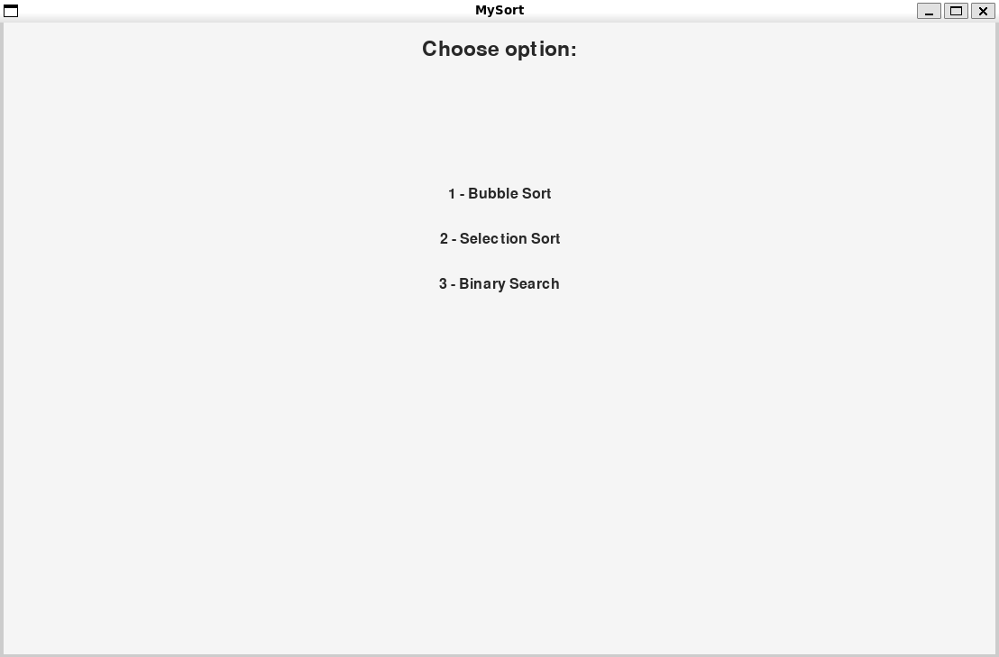
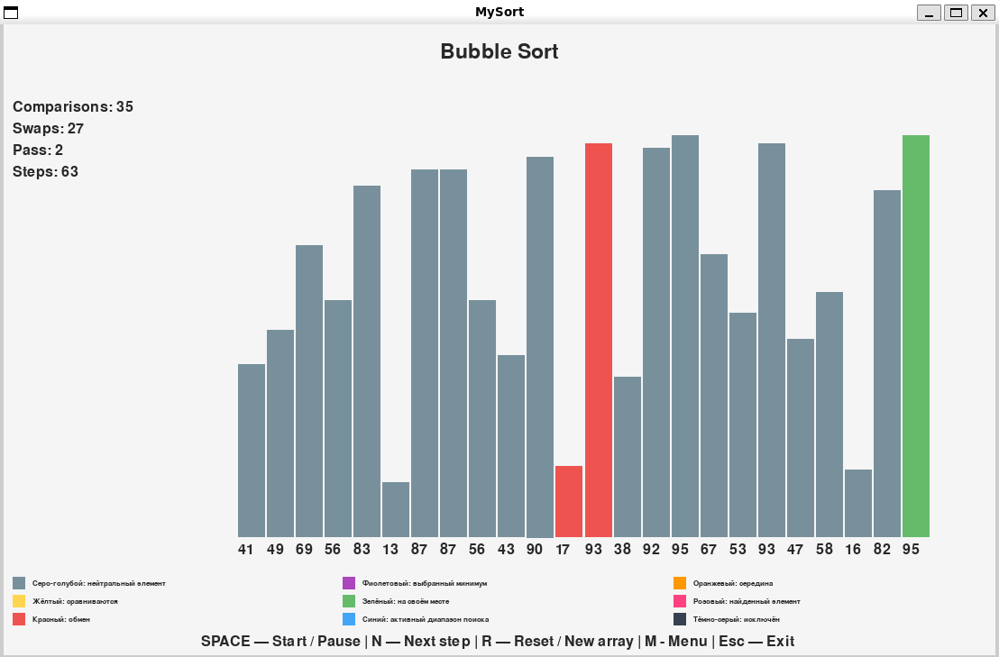
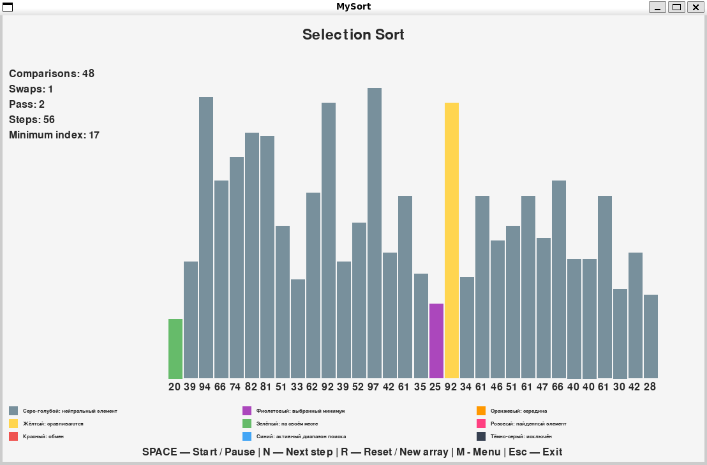
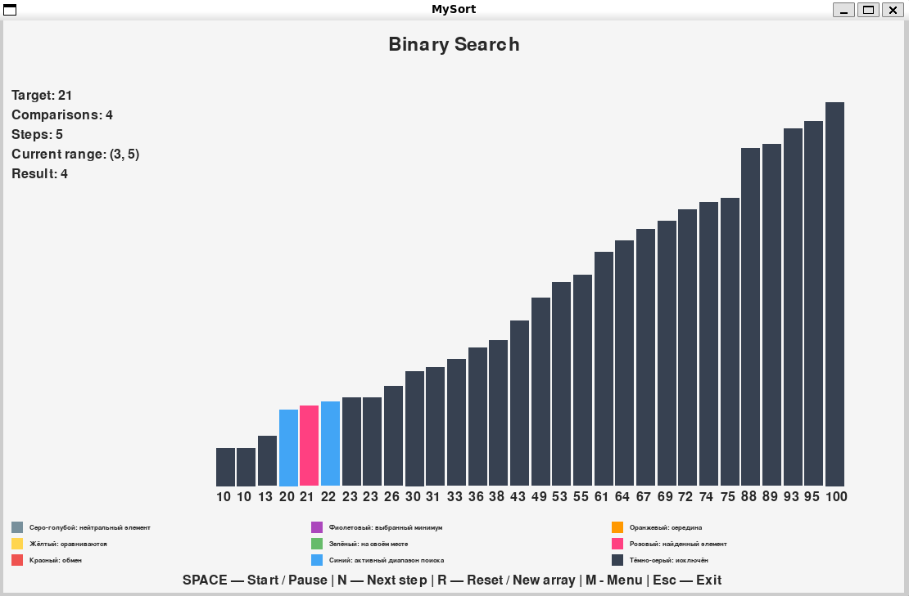

# Визуализация алгоритмов сортировки и бинарного поиска

Интерактивное приложение на **Python + PyGame**, которое пошагово показывает работу трёх алгоритмов:

1. пузырьковая сортировка (Bubble Sort);
2. сортировка выбором (Selection Sort);
3. бинарный поиск (Binary Search).

Приложение показывает не только результат, но и все промежуточные состояния: сравнения, обмены, границы поиска и статистику выполнения.

<!-- Скриншот: главное меню -->


---

## Запуск

Требования: Python 3.10+.

```bash
# (по желанию) создать виртуальное окружение
python -m venv venv
source venv/bin/activate        # Windows: venv\Scripts\activate

# установить зависимости
pip install -r requirements.txt

# запустить приложение
python main.py
```

> Клавиши `N`, `R`, `M` работают только на **английской раскладке** клавиатуры.

---

## Управление

| Клавиша | Действие |
|---------|----------|
| `1` | выбрать Bubble Sort |
| `2` | выбрать Selection Sort |
| `3` | выбрать Binary Search |
| `SPACE` | запуск / пауза автоматического выполнения |
| `N` | выполнить один шаг алгоритма |
| `R` | сбросить состояние и создать новый массив |
| `M` | вернуться в меню |
| `Esc` | выход (также работает кнопка закрытия окна) |

Все клавиши отображаются в нижней части окна.

Поведение клавиш одинаково в любой ситуации:

- `R` всегда останавливает выполнение, сбрасывает статистику и создаёт новый массив. Алгоритм после этого сам не запускается.
- `SPACE` только включает и выключает автоматическое выполнение, а один шаг делает `N`. Их можно сочетать: поставить паузу и идти по шагам через `N`.
- При переключении режима (`1/2/3`) и при возврате в меню состояние предыдущего алгоритма полностью сбрасывается.

---

## Интерфейс

Окно 1100 × 700 делится на зоны:

```text
┌──────────────────────────────────────────────┐
│ header: название выбранного алгоритма        │
├──────────┬───────────────────────────────────┤
│ stats    │ body: столбцы массива             │
│ статис-  │                                   │
│ тика     │                                   │
├──────────┴───────────────────────────────────┤
│ legend: легенда цветов                       │
├──────────────────────────────────────────────┤
│ controls: подсказка по клавишам              │
└──────────────────────────────────────────────┘
```

- **Заголовок** показывает выбранный алгоритм.
- **Область массива**: каждый элемент это вертикальный столбец, высота пропорциональна значению. Ширина столбца считается от количества элементов, поэтому массив любого размера заполняет область равномерно и не выходит за границы окна. Под столбцами выводятся значения.
- **Панель статистики** слева. После завершения алгоритма итоговые значения остаются на экране до сброса или смены режима.
- **Легенда** объясняет каждый цвет.
- **Подсказка** со всеми клавишами управления.

---

## Цвета состояний

Цвета едины для всех алгоритмов.

| Состояние | Цвет | Где используется |
|-----------|------|------------------|
| `normal` | серо-голубой | обычный элемент |
| `comparing` | жёлтый | сравниваемые элементы |
| `swapping` | красный | элементы, участвующие в обмене |
| `min` | фиолетовый | выбранный минимум (Selection Sort) |
| `sorted` | зелёный | элемент на своём месте |
| `range` | синий | активный диапазон бинарного поиска |
| `mid` | оранжевый | середина диапазона |
| `found` | розовый | найденный элемент |
| `excluded` | тёмно-серый | элемент, исключённый из поиска |

---

## Алгоритмы

### Bubble Sort

Показывает два сравниваемых соседних элемента, обмен, отсортированный хвост справа и конец каждого прохода. Реализована оптимизация раннего завершения: если за проход не было ни одного обмена, сортировка заканчивается досрочно.

Статистика: `Comparisons`, `Swaps`, `Pass`, `Steps`.

<!-- Скриншот: Bubble Sort в процессе -->


### Selection Sort

Показывает проверяемый элемент, индекс текущего минимума (фиолетовый столбец остаётся виден весь проход), обмен минимума с началом неотсортированной области и отсортированную часть слева. Обмен выполняется только если минимум не стоит на нужном месте.

Статистика: `Comparisons`, `Swaps`, `Pass`, `Steps`, `Minimum index`.

<!-- Скриншот: Selection Sort в процессе -->


### Binary Search

Поиск идёт по **отсортированному** массиву: при создании массива в этом режиме он сортируется. Искомое значение `target` выбирается случайно из элементов массива. Новое значение появляется при каждом нажатии `R`.

На каждом шаге показываются границы `left` и `right`, середина `mid`, исключённые элементы и найденный элемент. В конце выводится `Element found: index ...` или `Element not found`.

Статистика: `Target`, `Comparisons`, `Steps`, `Current range`, `Result`.

<!-- Скриншот: Binary Search, результат -->


---

## Архитектура

```text
algorithm_visualizer/
├── main.py
├── algorithms.py
├── visualizer.py
├── settings.py
└── README.md
```

| Файл | Назначение |
|------|------------|
| `main.py` | окно, event loop, обработка клавиш, переключение режимов, таймер шага |
| `algorithms.py` | три алгоритма в виде генераторов, без импорта PyGame |
| `visualizer.py` | вся отрисовка: раскладка окна, меню, столбцы, статистика, легенда |
| `settings.py` | константы: размеры, цвета, скорость, параметры массива, подписи |

### Независимость алгоритмов от PyGame

`algorithms.py` не импортирует PyGame и ничего не рисует. Каждый алгоритм это генератор, который через `yield` отдаёт словарь с описанием текущего шага. Визуализатор только читает этот словарь и переводит его в цвета и текст. Благодаря этому алгоритмы можно проверять в консоли без графики.

### Контракт шага (`yield`)

Сортировки отдают:

```python
{
    "type": "compare" | "swap" | "pass_end" | "done",   # Selection Sort: ещё "new_min"
    "indices": (i, j) | None,      # какие столбцы участвуют в шаге
    "sorted_from": 27,             # Bubble Sort: с этого индекса всё на месте (справа)
    "sorted_upto": 3,              # Selection Sort: всё левее этого индекса на месте
    "min_idx": 5,                  # Selection Sort: текущий минимум
    "stats": {"comparisons": 12, "swaps": 5, "pass": 2, "steps": 17},
}
```

Бинарный поиск отдаёт:

```python
{
    "type": "compare" | "found" | "not_found",
    "left": 0, "mid": 7, "right": 14,     # mid равен None при not_found
    "stats": {"target": 74, "comparisons": 3, "steps": 3,
              "current_range": (left, right), "result": None | index | -1},
}
```

Счётчики хранятся локальными переменными внутри генератора и между вызовами `next()` сохраняются. На каждом `yield` их текущие значения копируются в `stats`, поэтому цифры на экране всегда соответствуют нарисованному кадру. `steps` увеличивается перед каждым `yield`.

### Правила цвета

Для каждого режима есть своя функция `(i, step) -> ключ из COLORS`. Проверки идут по приоритету сверху вниз, побеждает первая сработавшая. Например, для Selection Sort:

1. участники обмена: `swapping`;
2. текущий минимум: `min`;
3. остальные участники шага: `comparing`;
4. левее `sorted_upto`: `sorted`;
5. остальное: `normal`.

Функции собраны в словарь `COLOR_RULES`, поэтому `draw_columns` одинаково работает для всех режимов и не знает, какой алгоритм сейчас запущен.

---

## Пошаговое выполнение без блокировок

`time.sleep` не используется. Шаги выполняются по связке **delta time + таймер шага + генератор**:

```python
dt = clock.tick(FPS)                    # время кадра в мс
if state["running"]:
    state["timer"] += dt
    if state["timer"] >= STEP_DELAY_MS:
        state["timer"] -= STEP_DELAY_MS
        advance(state)                  # один next(generator)
```

Вычитание `STEP_DELAY_MS` вместо обнуления делает скорость независимой от неточности интервала между кадрами. Пауза не останавливает event loop: окно продолжает реагировать на клавиши. Алгоритм не выполняется заранее целиком: за один вызов `advance` делается ровно один `yield`.

Скорость задаётся константой `STEP_DELAY_MS` в `settings.py` (по умолчанию 200 мс).

---

## Параметры (`settings.py`)

| Параметр | Значение |
|----------|----------|
| Размер окна | 1100 × 700 |
| Количество элементов | случайное от `ARRAY_SIZE_MIN` до `ARRAY_SIZE_MAX` (20–50) |
| Значения | 10–100 |
| Задержка шага | `STEP_DELAY_MS` = 200 мс |

---

## Известные ограничения

- В режиме Binary Search `target` всегда выбирается из массива, поэтому случай «элемент не найден» через интерфейс получить нельзя. Генератор этот случай поддерживает (шаг `not_found`), и проверить его можно в консоли, вызвав `binary_search_steps(arr, target)` со значением вне массива.
- Начало неотсортированной области в Selection Sort отдельно не выделено: граница видна по концу зелёной части слева.
- Клавиши `N`, `R`, `M` обрабатываются по символу, поэтому нужна английская раскладка.